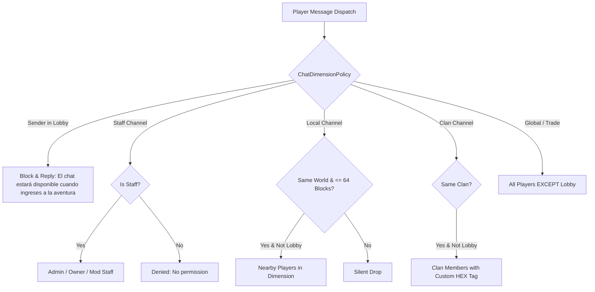

# CHAT DIMENSION POLICY & CHANNEL ARCHITECTURE 2.0

## 1. Executive Policy Overview
Chat System 2.0 establishes strict spatial and dimensional isolation across PokeReport Network:
- **Lobby (`lunaeternal:lobby`)**: **Silent Chat Mode**. Completely insulated from public chat noise, commerce spam, and proximity messages.
- **Ciudadela (`lunaeternal:ciudadela`)**: Full social hub supporting Global, Local (64 blocks), Commerce, Clan, and Private messaging, supplemented by periodic Official Announcements.
- **Hogar / Salvaje / Gimnasios**: Standard gameplay dimensions with Global, Commerce, Clan, and localized proximity channels.

---

## 2. Core Dimensional Registry

| Dimension Identifier | Technical Registry Key | Spawn Coordinates | Chat Policy State |
|---|---|---|---|
| **Lobby** | `lunaeternal:lobby` | `(40.23, 72.00, 48.00)` yaw `90.0°` | **SILENT CHAT MODE** (Zero social broadcast) |
| **Ciudadela** | `lunaeternal:ciudadela` | `(4.27, 70.00, 0.36)` yaw `0.0°` | **STANDARD SOCIAL HUB + ANNOUNCEMENTS** |
| **Mundo Hogar** | `minecraft:overworld` | World spawn | Standard Gameplay (Global / Local / Trade / Clan) |
| **Mundos Salvajes** | `lunaeternal:salvaje` (1-6) | Dynamic terrain surface | Standard Gameplay (Global / Local / Trade / Clan) |
| **Gimnasios** | `lunaeternal:gimnasios` | Arena offset coordinates | Battle Focus (Global / Staff / Private) |

---

## 3. Communication Channel Matrix

| Channel | Identifier | Prefix Tag | Scope | Lobby Recipient Allowed? | Lobby Sender Allowed? |
|---|---|---|---|---|---|
| **GLOBAL** | `global` / `g` | `§8[§aGlobal§8]` | Network-wide | **NO (Blocked)** | **NO (Blocked)** |
| **LOCAL** | `local` / `l` | `§8[§eLocal§8]` | Intra-dimension (radius 64m) | **NO (Blocked)** | **NO (Blocked)** |
| **COMERCIO** | `comercio` / `tr` | `§8[§6Comercio§8]`| Trade announcements | **NO (Blocked)** | **NO (Blocked)** |
| **CLAN** | `clan` / `c` | `§8[§bClan§8]` | Active clan members | **NO (Blocked)** | **NO (Blocked)** |
| **STAFF** | `staff` / `sc` | `§8[§cStaff§8]` | Admin / Owner / Mod | **YES (Staff Only)** | **YES (Staff Only)** |
| **PRIVADO** | `privado` / `msg` | `§8[§dPrivado§8]` | Direct 1-to-1 | Configurable (`false` default)| Configurable (`false` default) |

---

## 4. Lobby Silent Mode Specifications

When a player is physically located within `lunaeternal:lobby`:
1. **Inbound Suppression**:
   - `GLOBAL`, `LOCAL`, `COMERCIO`, and `CLAN` messages are completely filtered out.
   - Proximity chat from other players or adjacent coordinates never penetrates into Lobby.
   - Join/leave messages from standard players and paid ranks are suppressed.
2. **Outbound Protection**:
   - If a Lobby player types into the chat, `LobbyNetworkGuardMixin` cancels the packet at `HEAD`.
   - The player receives discrete local feedback:
     `"§6§lPOKEREPORT §8» §7El chat estará disponible cuando ingreses a la aventura."`
   - The attempted text is never transmitted across the network or logged as chat.
3. **Allowed Communications in Lobby**:
   - Authentication commands: `/login`, `/register`, `/l`, `/reg`.
   - Personal system messages (errors, command confirmations, door status).
   - Periodic Official Announcements (`ServerAnnouncementService`).
   - Direct administrative messages sent by Staff.

---

## 5. Visual Formatting & Clean-Room Identity
- **Rank Tags**: Rendered with **FIXED PokeReport colors** via `Tablist.Rank` (`Formatting.GOLD` for Leyenda, `DARK_PURPLE` for Maestro, `AQUA` for Campeón, `GREEN` for Élite, `WHITE` for Entrenador).
- **Clan Tags**: Rendered with **CUSTOM HEX GRADIENTS** via `Tablist.tagText(ClanInfo)`, supporting full 24-bit TrueColor per character (e.g. `#55FFFF` to `#FFAA00`).
- **Clean Separation**: Visual client enhancements (`Chat Heads` and `Chat Animation`) render cleanly over this structured backend format without altering protocol compatibility.
