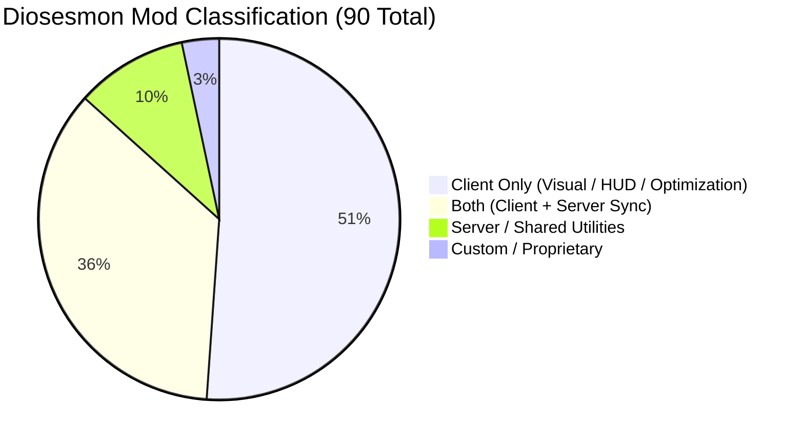

# DIOSÉSMON FORENSIC MOD AUDIT & COMPARISON

## 1. Audit Context & Scope
- **Source Target**: `C:\Users\JUAN\AppData\Roaming\FreesmLauncher\instances\Diosesmon Official PRO-1.0.10\minecraft\mods`
- **Audit Execution Date**: 08/10/2026
- **Reference Target**: PokeReport Network (`LunaEternal 0.1.0`, Minecraft 1.21.1 Fabric)
- **Methodology**: Automated parsing of `fabric.mod.json`, JAR manifest analysis, and checksum generation (`SHA-256`).

---

## 2. Core Environment Comparison

| Parameter | Diosésemon Instance | PokeReport Network (Current) | Variance Analysis |
|---|---|---|---|
| **Minecraft Version** | 1.21.1 | 1.21.1 | Parity |
| **Mod Loader** | Fabric Loader 0.16.9 | Fabric Loader 0.16.9 / 0.18.4 runtime | Parity |
| **Cobblemon Version** | **1.7.3+1.21.1** | **1.8.0+1.21.1** | **Major divergence**: PokeReport is ahead on Cobblemon 1.8.0. Diosésemon is pinned to legacy 1.7.3. |
| **Total Mods** | 90 JAR files | 64 active mods | Diosésemon includes client-side cosmetic/chat mods. |
| **Total Size** | ~144.8 MB | ~112.4 MB | Difference driven by duplicate asset jars and client utilities. |

---

## 3. Mod Distribution Breakdown

- **Client Only (46 mods)**:
  - Rendering / Shaders: `iris-1.8.8+1.21.1-fabric.jar`, `sodium-fabric-0.6.13+mc1.21.1.jar`, `indium-1.0.35+mc1.21.1.jar`
  - Optimizations: `bobby-5.2.4.1.jar`, `entityculling-fabric-1.10.1-mc1.21.1.jar`, `ferritecore-7.0.3-fabric.jar`, `immediatelyfast-fabric-1.6.10+1.21.1.jar`, `krypton-0.2.8.jar`, `lithium-fabric-0.15.3-mc1.21.1.jar`, `modernfix-fabric-5.25.1+mc1.21.1.jar`, `moreculling-fabric-1.0.7-mc1.21.1.jar`, `badorptimizations-2.4.1.jar`
  - HUD / Chat: `chat_heads-0.13.19-fabric-1.21.1.jar`, `ChatAnimation-fabric-1.21-1.0.3.jar`, `ImmersiveUI-1.21.1-1.1.2.jar`, `jade-fabric-1.21.1-15.10.1.jar`, `xaeros_minimap_24.7.1_fabric.jar`, `xaeros_world_map_1.39.1_fabric.jar`
  - Audio: `presencefootsteps-1.21.1-1.10.4.jar`
- **Both / Network-Synced (32 mods)**:
  - Cobblemon ecosystem: `Cobblemon-fabric-1.7.3+1.21.1.jar`, `cobbledollars-1.2.4.jar`, `CobblemonFightOrFlight-1.21.1-0.6.2.jar`, `cobblemonintegrations-1.21.1-fabric-1.4.1.jar`, `cobblemon-party-overlay-1.4.0.jar`
  - RCT & Combat: `rct-0.19.0-beta.jar`, `rctapi-0.16.0-beta.jar`
  - World & Blocks: `architectury-13.0.8-fabric.jar`, `cloth-config-15.0.140-fabric.jar`
- **Custom / Proprietary (3 mods)**:
  - `diosesmon-1.7.12.jar` (Namespace: `diosesmon-client`, Author: Diosesmon Dev Team, License: **All Rights Reserved**).
  - Contains proprietary network hooks, custom brand splash, and server telemetry for Diosesmon Network.

---

## 4. Key Architectural Findings
1. **Cobblemon 1.7.3 vs 1.8.0**:
   - Diosésemon runs Cobblemon 1.7.3 which has known model glitches on early Gen 2 sprites, missing animations for some evolutions, and older Showdown RPC structures.
   - PokeReport is natively standardized on Cobblemon 1.8.0, offering improved physics, native particle effects, and fixed evolution sequences.
2. **Performance Stack Quality**:
   - The optimization stack in Diosésemon (`Sodium` + `Lithium` + `ImmediatelyFast` + `FerriteCore` + `ModernFix` + `BadOptimizations`) is highly tuned for FPS stability and lower GC churn.
   - Recommended for adoption into PokeReport's upcoming client release bundle.
3. **Proprietary Wall**:
   - `diosesmon-1.7.12.jar` MUST NOT be reused, extracted, or distributed. PokeReport maintains complete clean-room autonomy.
