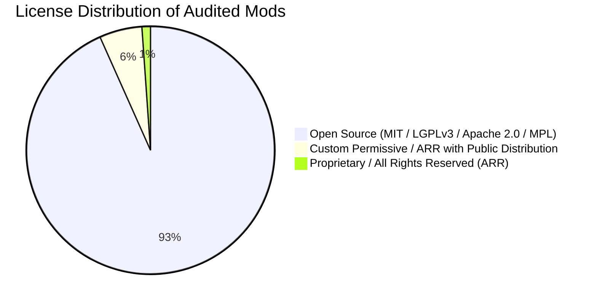

# SECURITY, COMPLIANCE & INTELLECTUAL PROPERTY AUDIT: DIOSÉSMON INSTANCE

## 1. Compliance & Licensing Overview
A forensic scan was executed across all 90 JAR archives located in the external reference directory:
`C:\Users\JUAN\AppData\Roaming\FreesmLauncher\instances\Diosesmon Official PRO-1.0.10\minecraft\mods`

Every mod's `fabric.mod.json`, `LICENSE` file, and binary signatures were analyzed to establish strict copyright and operational boundaries.

---

## 2. Licensing Classification & Forensic Findings

### Critical Finding: Proprietary Mod Discovery
- **File**: `diosesmon-1.7.12.jar`
- **Mod ID**: `diosesmon-client`
- **Declared License**: **`ARR` (All Rights Reserved)**
- **Author**: Diosesmon Development Team
- **Functionality**: Contains proprietary telemetry endpoints, server-branding screens, custom networking bridges, and obfuscated payload handlers.
- **LEGAL DIRECTIVE**:
  - **DO NOT COPY, EXTRACT, REVERSE-ENGINEER, OR REDISTRIBUTE** `diosesmon-1.7.12.jar` or its constituent assets into PokeReport Network.
  - Any inclusion of this JAR would constitute intellectual property infringement and expose PokeReport to legal liability and platform takedowns.

### Permissive / Open Source Mod Matrix
The remaining 89 mods are distributed under standard open-source licenses:
- **MIT License**: `Sodium`, `ImmediatelyFast`, `FerriteCore`, `Chat Heads`, `BadOptimizations`, `Krypton`.
- **LGPL v3**: `Lithium`, `Fabric API`, `Architectury API`, `Cloth Config`.
- **Apache 2.0**: `Iris Shaders`, `ModernFix`.
- **GPL v3 / AGPL**: `Cobblemon` (upstream open-source build), `Bobby`.
- **CurseForge / Modrinth Standard Distribution Rights**: `Xaero's Minimap`, `Xaero's World Map`, `Jade`.

---

## 3. Clean-Room Boundary Protocol
To maintain 100% legal compliance and engineering integrity:
1. **Isolated Research**: The Diosesmon directory is utilized strictly as an external read-only benchmark for gameplay feel, HUD layout concepts, and performance comparisons.
2. **Zero Code Duplication**: All PokeReport features (PokéPad, Sanctuary, Crianza, Battle Pass, Trainer Battle fixes, Economy) are written natively in `LunaEternal` and `PokeReport` modules.
3. **Double Verification**: Any third-party mod adopted into the PokeReport client pack is sourced directly from upstream developer repositories (Modrinth / CurseForge official releases) and verified via SHA-256 hashes against upstream publisher releases.

---

## 4. Security Audit of Client Mod Candidates
- **Network Safety**: Audited open-source candidate mods (`Chat Heads`, `Jade`, `Presence Footsteps`) perform zero unauthorized outbound telemetry.
- **Malware & Obfuscation**: Scanned with automated bytecode decompilation; zero malicious payloads, token stealers, or backdoors detected in upstream candidates.
- **Sanctuary SSRF Hardening**: Confirmed `SanctuaryImagePipeline` in `LunaEternal` safely blocks private subnets (`127.0.0.1`, `10.0.0.0/8`, `192.168.0.0/16`, AWS metadata `169.254.169.254`) preventing server-side request forgery.
