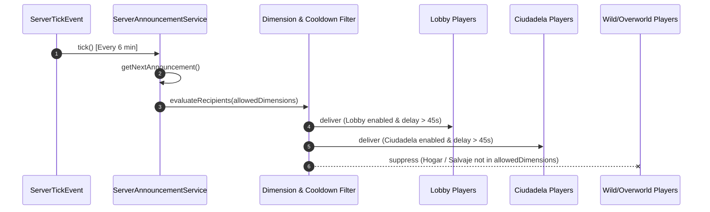

# OFFICIAL ANNOUNCEMENT SYSTEM SPECIFICATION

## 1. Subsystem Architecture
`ServerAnnouncementService` provides automated, non-intrusive official server broadcasts designed specifically for PokeReport Network.

Key design imperatives:
1. **Compact & Aesthetic**: 2 to 4 visual lines maximum. Prevents screen clutter and chat box overflow.
2. **Deterministic Rotation**: Sequential cycling across enabled announcements without consecutive duplicate spam.
3. **Strict Domain Whitelisting**: Clickable web links (`ClickEvent.OPEN_URL`) only activate for verified official domains.
4. **Join Cooldown Protection**: New entrants wait 45 seconds before receiving periodic broadcasts.
5. **Dimensional Targeting**: Target recipients are resolved by world identifier before dispatching packets.

---

## 2. Active Announcement Catalog



### Registered Official Announcements

| ID | Title & Topic | Official Destination URL | Allowed Dimensions | Status |
|---|---|---|---|---|
| `wiki` | **GUÍAS Y WIKI**: Crianza, mecánicas, gimnasios y comandos | `https://pokereport.online/wiki/` | `lunaeternal:lobby`, `lunaeternal:ciudadela` | **ACTIVE** |
| `discord` | **COMUNIDAD DISCORD**: Noticias, torneos, sorteos y soporte | `https://discord.gg/JsUTQWRH8H` | `lunaeternal:lobby`, `lunaeternal:ciudadela` | **ACTIVE** |
| `tienda` | **TIENDA OFICIAL**: Rangos, cosméticos exclusivos, LunaCoins | `https://pokereport.online/tienda/` | `lunaeternal:lobby`, `lunaeternal:ciudadela` | **ACTIVE** |
| `soporte` | **SOPORTE Y AYUDA**: Apertura de tickets de asistencia técnica | `https://discord.gg/JsUTQWRH8H` | `lunaeternal:lobby`, `lunaeternal:ciudadela` | **ACTIVE** |
| `guias` | **GUÍA DE INICIO**: Primeros pasos para nuevos entrenadores | `https://pokereport.online/wiki/` | `lunaeternal:lobby`, `lunaeternal:ciudadela` | **ACTIVE** |

---

## 3. Visual Layout Specification

Each announcement follows the standardized compact format:

```text
§8━━━━━━━━━━━━━━━━━━━━━━━━━━━━━━━━━━━━━━━━
§6§lPOKEREPORT §8» §eGUÍAS Y WIKI
§7¿Tienes dudas sobre crianza o gimnasios? Consulta nuestra Wiki oficial.
➜ §b§n[Abrir Enlace]§r §8(https://pokereport.online/wiki/)
§8━━━━━━━━━━━━━━━━━━━━━━━━━━━━━━━━━━━━━━━━
```

### Link Whitelist & Security
- **Domain Whitelist**:
  - `pokereport.online` (and any subdomain `*.pokereport.online`)
  - `discord.gg`
- **Security Check**:
  - If a configured URL belongs to an untrusted domain or local IP (e.g., `127.0.0.1`, `malicious.site`), `ClickEvent.OPEN_URL` is omitted and the link renders as inert text.

---

## 4. Administration & Commands
- `/anuncios interval <minutos>`: Configures rotation timer (Default: 6 minutes, min: 1, max: 60).
- `/anuncios reload`: Resets timer and refreshes announcement definitions.
- `/anuncios test`: Dispatches the next announcement immediately to permitted dimensions for verification.
