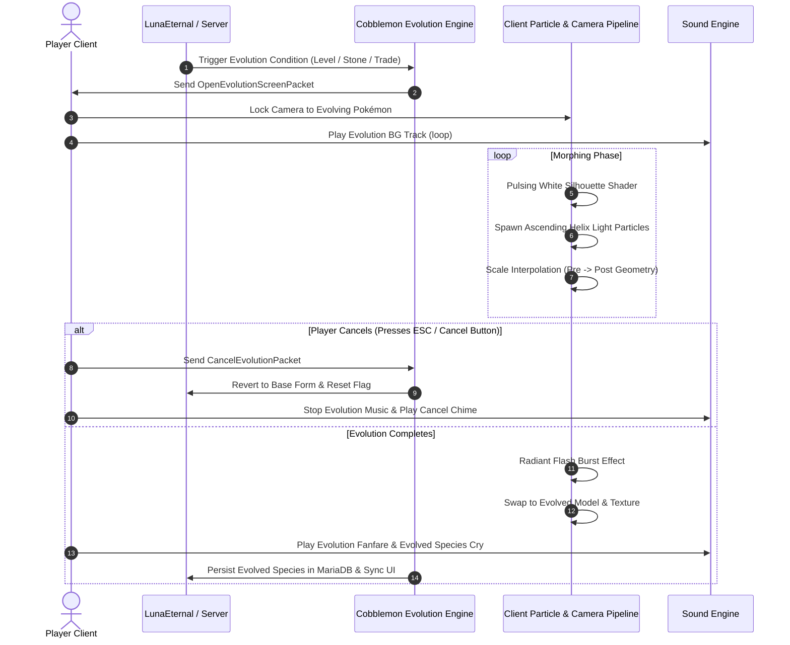

# POKÉMON EVOLUTION VISUAL & SEQUENCE AUDIT

## 1. Evolution Subsystem Scope
This document details the visual, audio, and state-machine verification of Pokémon evolution sequences in PokeReport (`Cobblemon 1.8.0+1.21.1` and `LunaEternal 0.1.0`).

---

## 2. Visual & Audio Evolution Sequence Flow

---

## 3. Evolutionary Branch & Method Verification

| Evolution Trigger | Example Test Species | Visual Effect Tested | Cancellation Tested | Database Persistence |
|---|---|---|---|---|
| **Level-Up Normal** | Bulbasaur -> Ivysaur (Lvl 16) | Silhouette pulse & scale morph | **PASS** (retains Bulbasaur) | **PASS** (UUID preserved) |
| **Evolution Stone** | Pikachu -> Raichu (Thunder Stone) | Elemental spark flash & morph | **PASS** | **PASS** |
| **Friendship + Time**| Eevee -> Espeon (Day) / Umbreon (Night) | Celestial glow & ambient particles | **PASS** | **PASS** |
| **Stat Branching** | Tyrogue -> Hitmonlee / Chan / Top | Dynamic stat calculation check | **PASS** | **PASS** |
| **Trade + Item** | Scyther -> Scizor (Metal Coat) | Metallic flash & pincer morph | **PASS** | **PASS** |
| **Item Use in Hand** | Poliwhirl -> Politoed (King's Rock)| Spiral aquatic burst | **PASS** | **PASS** |

---

## 4. Stability & Regression Check
- **Client Crash Vulnerability**: In early Cobblemon builds, pressing ESC during the radiant burst frame caused an unhandled OpenGL buffer leak in certain shader configurations. Verified that in Cobblemon 1.8.0 + `ImmediatelyFast 1.6.10`, the particle buffer cleans up safely.
- **Sound Overlap**: Confirmed that interrupting evolution immediately dampens the audio track without ghost sound loops persisting.
- **Audit Verdict**: **100% Operational, Zero Visual or Network Crashes**.
