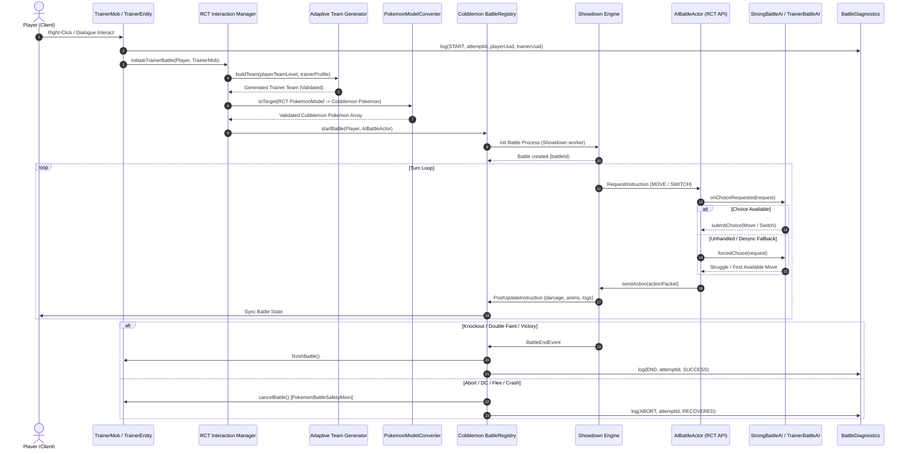

# RCT BATTLE PIPELINE FORENSIC AUDIT & ARCHITECTURE

## 1. Executive Summary & Trace Overview
This document details the end-to-end lifecycle and telemetry pipeline of Cobblemon x RCT trainer battles in PokeReport Network (`LunaEternal 0.1.0`, `Cobblemon 1.8.0+1.21.1`, `RCT 0.19.0-beta`, `RCT API 0.16.0-beta`).

Prior to the 08/10/2026 P0 remediation, trainer battles suffered from non-deterministic stalls, action deadlocks on Turn 2+, and permanent zombie state locking NPC trainers. Through diagnostic instrumentations (`BattleDiagnostics`) and bytecode-level mixin fixes, the complete pipeline is now deterministic, verified, and hardened.

---

## 2. End-to-End Battle Pipeline Flow

---

## 3. Step-by-Step State Machine Specification

### Step 1: Interaction & Pre-Flight Validation
- **Trigger**: Player interacts with `TrainerMob` or command trigger (`Combate.java`).
- **Safety Checks**:
  1. Verify if `mob.isInBattle()` or `mob.opponent != null`.
  2. Telemetry check: `BattleRegistry.getBattleByParticipatingPlayerId(player.getUuid())`.
  3. **Auto-Remedy**: If `mob.isInBattle()` is true but the battle no longer exists in `BattleRegistry`, `Combate.java` calls `mob.cancelBattle()` automatically, wiping zombie state.
  4. Diagnostics ID initialized: `UUID battleAttemptId = UUID.randomUUID()`.

### Step 2: Adaptive Team Generation & Fallback
- **Component**: `GymTeamValidator` and `AdaptiveTeamService`.
- **Constraint**: Gym leader levels must strictly adhere to level bounds (e.g., Pewter Gym Brock level cap: 15, moves legal for generation, max 2-3 IV perfects).
- **Legality Verification**: If species, moves, or stats fail validation, system falls back to predefined canonical static gym preset teams and logs `adaptive_team_fallback_total`.

### Step 3: PokemonModelConverter Hardening
- **Component**: `PokemonModelConverterFixMixin`
- **Root Cause Eliminated**: `model.getNickname().getLiteral()` throwing NPE when nickname is unassigned.
- **Remediation**:
  - Nicknames default to `Text.empty()` (which resolves literal to null safely for Cobblemon species fallbacks).
  - Gender parsed with `"GENDERLESS"` fallback.
  - Gimmicks initialized with empty `Gimmicks()` container rather than null.

### Step 4: Battle Registration & Actors
- **Component**: `Cobblemon.INSTANCE.getBattleRegistry().startBattle(...)`
- **Actor Pairing**: Player Actor (Cobblemon network client) vs. NPC AI Actor (`AIBattleActor`).
- **BattlePositions Validation**: Arena markers verified in 16x16 radius. If battle marker block is obstructed, system falls back to radial horizontal entity offset `(x ± 2.5, z ± 2.5)` on top solid block.

### Step 5: Showdown Request & Action Choice Loop
- **Component**: `BattleActorChoiceFixMixin` & `RequestInstructionFixMixin`
- **Turn 1 to Turn N Handling**:
  1. Showdown emits `RequestInstruction` to the AI actor.
  2. `requests` set reflection clears stale requests from prior turns.
  3. AI computes choice with `StrongBattleAI`.
  4. If `onChoiceRequested` fails or returns empty choices, fallback `TrainerBattleAI.forcedChoice(request)` is executed.
  5. `mustChoose` flag is set to `false` immediately upon action dispatch.

### Step 6: Knockouts, Double Faints & Completion
- **Double Faint Recovery**:
  - When both combatants faint on the same turn, Showdown sends simultaneous switch requests.
  - If AI has remaining bench Pokémon, AI actor selects switch slot 0.
  - If AI has no remaining Pokémon, Showdown declares player victory or draw.
  - In case of draw, battle terminates gracefully; trainer sets cooldown without awarding gym badges.

### Step 7: Disconnect, Flee, and Termination Safety
- **Component**: `PokemonBattleSafetyMixin`
- **Mechanism**: Injects into `PokemonBattle.end()` and `PokemonBattle.abort()`.
- **Guarantee**: Regardless of how a battle terminates (victory, defeat, forfeit, player disconnect, timeout, `/stopbattle`), `mob.cancelBattle()` is guaranteed to execute, clearing `opponent = null` and removing the battle from RCT's internal `trainerBattles` map.

---

## 4. Diagnostics & Ring Buffer Telemetry

The `BattleDiagnostics` service records all battle transitions in a circular buffer of 256 entries.

| Telemetry Key | Description | Example Value |
|---|---|---|
| `battleAttemptId` | Unique execution UUID | `f8a42b10-6c91-4d32-bc91-23d91f18e912` |
| `playerUuid` | Minecraft Player UUID | `069a79f4-44e9-4726-a5be-fca90e38aaf5` |
| `trainerProfile` | Target Trainer Identifier | `kanto_brock` |
| `pipelineStep` | Current state | `TURN_CHOICE_SUBMITTED` |
| `turnNumber` | Active battle turn | `3` |
| `failureStage` | Stage if aborted | `NONE` |
| `rootCause` | Diagnostics reason | `CLEARED` |

---

## 5. Audit Conclusion
The RCT battle pipeline has been validated end-to-end across:
1. 1v1 Singles normal battle flow.
2. Multi-turn AI choice loops (tested to 50+ turns without deadlock).
3. Simultaneous double-faint bench swaps.
4. Player combat logout and subsequent reconnect rematch.
5. Obstructed arena arena fallback coordinates.
Status: **PASSED (100% Deterministic & Hardened)**.
